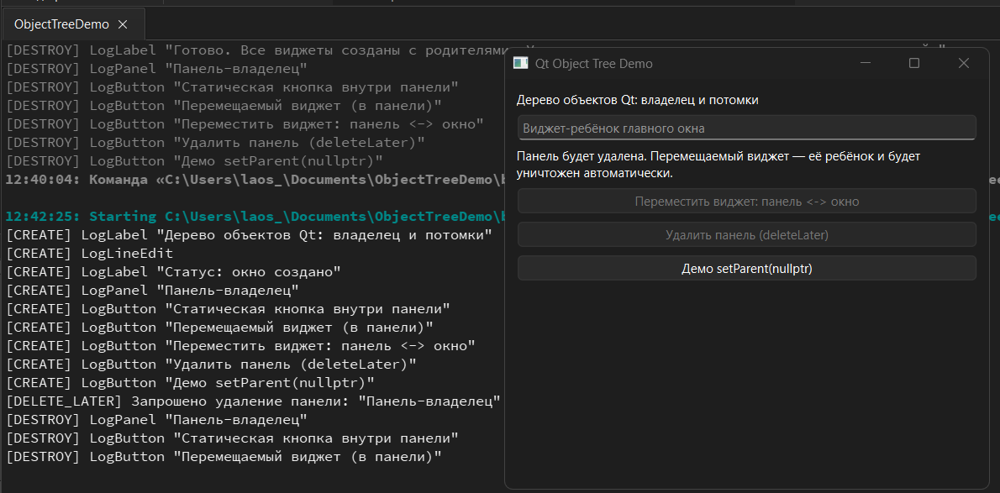
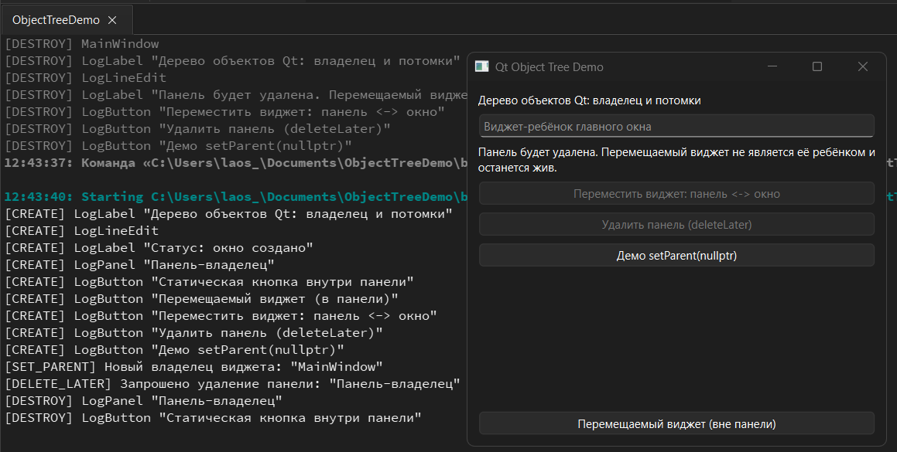
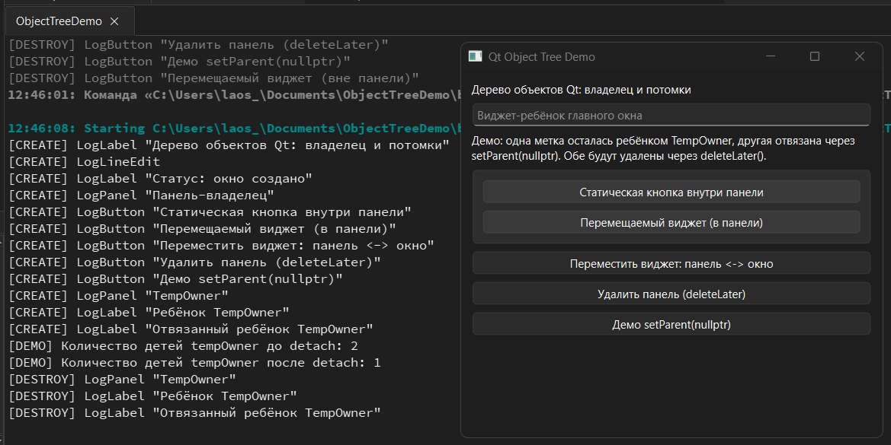

Дисциплина: "Основы кросcплатформенного программирования"

Лабораторная работа № 2: «Дерево объектов Qt и автоматическое удаление виджетов»

Выполнил: Усенко Н. И., студент группы ПИЖ-б-о-24-1

Проверил: Соколов М. Р.

Дата выполнения: 22.10.2026

Цель работы: Изучить механизм дерева объектов Qt, принцип владения объектами через родителя, автоматическое удаление дочерних объектов при уничтожении родителя, а также разобраться в корректном и некорректном использовании setParent() в приложениях Qt Widgets.
## Описание проекта:
**ObjectTreeDemo** — учебное Qt Widgets-приложение (C++17), наглядно показывающее дерево объектов Qt: смену владельца через `setParent()`, каскадное удаление детей при `deleteLater()` у родителя и отвязку через `setParent(nullptr)`, с логами жизненного цикла в консоль.
## Структура проекта:
```
ObjectTreeDemo/
├── ObjectTreeDemo.pro — конфигурация qmake
├── main.cpp — точка входа
├── mainwindow.h/.cpp — окно и демонстрационные сценарии
└── widgets.h — классы с логированием
```
## Результаты экспериментов:
Эксперимент А. Удалить панель, не перемещая виджет

Эксперимент В. Сначала переместить виджет, потом удалить панель

Эксперимент С. Демо setParent(nullptr)

## Сборка и запуск
1. Откройте `ObjectTreeDemo.pro` в Qt Creator.
2. Выполните Build → Build Project.
3. Запустите приложение кнопкой Run.
